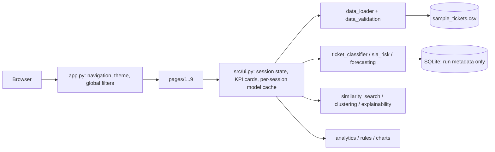

# SupportIQ AI — Intelligent Customer Support Analytics

An end-to-end, locally-executable analytics platform that turns support tickets into insight with NLP, machine learning, forecasting and explainability. Built with Streamlit, scikit-learn and Plotly. No paid APIs, no API keys, no external LLM calls: your data never leaves the app.

> Independent portfolio project. Not affiliated with or endorsed by Microsoft or any other company. The UI is inspired by modern enterprise dashboards but uses its own styling.

**Demo data notice.** The bundled `data/sample_tickets.csv` is **synthetic** (generated by `scripts/generate_sample_data.py`, seed 42). Every number shown while the demo is loaded describes that synthetic data and says nothing about real-world performance. The UI labels this everywhere.

## Features

| Page | What works |
|---|---|
| Executive Overview | 8 KPI cards with definitions, volume trend (D/W/M), priority, category, product×channel, resolution histogram, category×priority heatmap, recent tickets. Click a priority/category bar to filter the whole app. |
| Ticket Explorer | Text search, sort, pagination, per-ticket detail, CSV export of the filtered view. |
| AI Ticket Analyzer | Single-ticket category (ML) with confidence + low-confidence flag, class scores, term-level explanation, priority recommendation (ML model **plus** keyword rule, labelled separately), ML SLA-risk estimate when valid, rule-based next actions, batch CSV prediction + download. |
| SLA Risk Intelligence | Rule-based deadline monitor (met / late / overdue / at risk), configurable per-priority policy hours, ML breach model (chronological split; precision, recall, F1, PR-AUC, Brier, calibration), risk-ranked open tickets with contributing factors, breach drivers. |
| Volume Forecasting | Daily/weekly/monthly counts, moving-average / seasonal-naive / seasonal-average baselines, rolling-origin backtests (MAE, RMSE, MAPE, WAPE), approximate 95% intervals, peak & capacity planning, seasonality charts. Refuses to forecast on insufficient history. |
| Similar Incident Search | TF-IDF cosine top-k search with matching terms, self-exclusion, filters; "similar to ticket"; K-Means clusters with PCA map, keywords, ARI vs. labelled categories; optional lazy Sentence-Transformers mode. |
| Customer & Product Insights | Top customers, repeat-contact rate, product×category, resolution by product, response/resolution by channel. |
| Model Performance | Split details, accuracy/macro-F1/weighted-F1/precision/recall, per-class table, confusion matrix, error analysis, confidence distribution, top terms per class, LR vs Linear SVM, calibration error, measured latency & training time, run history. |
| Data Import & Config | Drag-and-drop CSV, auto column mapping + manual override, validation report (missing, duplicates, invalid dates, malformed rows), missing-value policy, preview, reset to demo, sample download. |

Metrics that the data cannot support show **"Not available"** instead of an invented value.

## Architecture



Data and models live in `st.session_state` (per browser session). Nothing is shared between users; ticket text is never written to disk or logged. SQLite stores only run metadata (timestamp, row count, metrics).

## Tech stack
Python 3.12 · Streamlit · pandas / NumPy · scikit-learn (TF-IDF word+char n-grams, Logistic Regression, Linear SVM, K-Means, PCA) · Plotly · SQLite · pytest. Optional: sentence-transformers (not installed by default).

## Dataset schema
Only a text column is required. Auto-detected (case-insensitive synonyms) or mapped manually:

`ticket_id, subject, description, category, priority, status, created_at, resolved_at, first_response_at, sla_deadline, product, channel, customer_id`

- Timestamps are parsed to timezone-naive UTC; unparseable values become missing (never guessed).
- Priority is normalised to Critical/High/Medium/Low (e.g. `P1`, `urgent`); status to Open/In Progress/Pending/Resolved/Closed.
- "Unresolved" = status in Open/In Progress/Pending, or (without a status column) no `resolved_at`.
- "Now" for SLA calculations = the latest timestamp in the data, so results are reproducible.

## Setup

```bash
git clone <your-repo-url> supportiq-ai && cd supportiq-ai
```
**Linux / macOS**
```bash
python3 -m venv .venv && source .venv/bin/activate
pip install -r requirements-dev.txt
```
**Windows (PowerShell)**
```powershell
py -3.12 -m venv .venv; .venv\Scripts\Activate.ps1
pip install -r requirements-dev.txt
```
Run: `streamlit run app.py` → http://localhost:8501 · Tests: `python -m pytest -q` · Regenerate demo data: `python scripts/generate_sample_data.py` · Timings: `python scripts/benchmark.py`

## Methodology
- **Text**: subject (weighted ×2) + description → whitespace-normalised.
- **Classifier**: `FeatureUnion` of word 1–2-gram and char_wb 3–5-gram TF-IDF → Logistic Regression (balanced class weights). Linear SVM is trained on the same features for comparison only.
- **Evaluation**: stratified 80/20 hold-out, seed 42; vectoriser fitted on the training split only; the primary model is fixed in advance (not picked on the test set). Classes with < 5 examples are dropped and reported; < 60 labelled tickets or < 2 classes → the app declines to train. The deployed model is the one that was evaluated.
- **Confidence** = top-class softmax probability; expected calibration error is reported. It is a score, not a guarantee.
- **SLA ML model**: trained only when real `sla_deadline` + `resolved_at` outcomes exist (≥ 100 resolved, ≥ 15 per class). Creation-time features only (no leakage); train on the earliest 75% by `created_at`, test on the latest 25%. Policy-derived deadlines are never used as training labels.
- **Forecasting**: rolling-origin backtests (up to 3 folds, chronological); best method by MAE; interval = forecast ± 1.96 × backtest RMSE (approximate).
- **Explainability**: term contribution = TF-IDF value × class coefficient (native to linear models; no SHAP dependency).

### Results on the synthetic demo data (this repo, this machine)
| Item | Result |
|---|---|
| Category classifier (n_test = 350) | accuracy 0.954, macro-F1 0.954 |
| SLA breach model (chronological test) | PR-AUC 0.449 vs 0.255 random baseline; precision 0.386, recall 0.606, F1 0.471 @0.5 |

The category score is high because the demo tickets are template-generated (with ~19% injected ambiguity/label noise). **Do not quote it as real-world accuracy.** Re-measure on your own data.

## Performance (measured with `scripts/benchmark.py`, 1,747 demo rows, this sandbox)
Load+validate 0.05 s · classifier training 0.7 s · single prediction 1.4 ms · 1,000-ticket batch 0.17 s · SLA model 0.11 s · search index 0.04 s · clustering 0.65 s · daily forecast 0.01 s · peak process memory for the whole ML pipeline ≈ 252 MB · Streamlit server answered its health check ≈ 0.9 s after launch.

Not measured: behaviour on Render's free instance (cold starts, memory with Streamlit loaded). Recommended maximum on a 512 MB instance: **≈ 20,000 rows** (`SUPPORTIQ_MAX_ROWS=20000` in `render.yaml`); hard app limit is configurable via env vars. Models train once per dataset per session; similarity indexes are sparse, top-k, and capped at 20,000 rows; clustering samples ≤ 5,000 rows.

## Privacy & security
No external calls; uploads processed in-memory, per session; ticket text never logged or persisted; CSV exports neutralise spreadsheet formula injection; upload size/row limits; `.gitignore` excludes datasets, DBs, secrets. Do not upload data you are not permitted to process on the host you deploy to.

## Deploy to Render
1. Push to GitHub. 2. Render → **New → Blueprint** → select the repo (uses `render.yaml`), or **New → Web Service** with build `pip install -r requirements.txt` and start `streamlit run app.py --server.port $PORT --server.address 0.0.0.0`. 3. Health check path `/_stcore/health`. 4. Python is pinned via `PYTHON_VERSION` / `.python-version` (`runtime.txt` included for other platforms).

Free tier caveats: the service sleeps when idle (cold start of tens of seconds), 512 MB RAM, **ephemeral filesystem** — the SQLite run history resets on restart/redeploy and uploads are never stored. The bundled demo data is re-read from the repo, so the demo is always reproducible. For durable history use a Render disk or managed Postgres (not included).

## Known limitations
- Visual layout was checked only through Streamlit's headless test harness, not in a browser; verify on desktop and mobile after deploying and add real screenshots.
- Light/dark switch works by CSS overrides on top of the dark base theme in `.streamlit/config.toml`; a few native widgets may keep dark styling.
- Optional semantic search requires `pip install sentence-transformers` and has **not** been exercised in this environment.
- Forecasting uses transparent baselines (no ARIMA/ETS); monthly forecasts need ≥ 12 complete months.
- Priority prediction from text alone is weak on the demo data; treat it as a hint beside the keyword rule.
- No live deployment was performed from the authoring environment.

## Future enhancements
Persistent storage (Postgres), authentication, calibrated probabilities (isotonic/Platt), ARIMA/ETS or Prophet forecasts, incremental learning from analyst corrections, ticket-reply drafting with a locally-hosted model.

## Screenshots
Run the app and capture real screenshots into `docs/screenshots/` (Executive Overview, Analyzer, SLA, Forecasting, Model Performance), then reference them here, e.g. ``.

## Resume bullet templates (fill with YOUR measured results)
- Built a Streamlit analytics platform that classifies support tickets with TF-IDF + Logistic Regression, reaching **<macro-F1>** macro-F1 on a stratified hold-out of **<n>** real tickets.
- Implemented chronological SLA-breach prediction (PR-AUC **<x>** vs **<baseline>** baseline) and backtested volume forecasts (WAPE **<y>%**).
- Delivered a deployable app with **<N>** automated tests, sub-**<ms>** prediction latency measured on **<instance>**.
